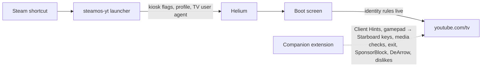

# SteamOS YT

YouTube's TV interface on SteamOS, running in [Helium](https://helium.computer) as a full-screen kiosk and launched from the Steam library like any other game, with its own artwork and controller support.


## Features

- **Console UI**: YouTube on TV (the interface used by consoles and smart TVs), not the desktop site.
- **One-command install**: no root access, no `steamos-readonly` changes; everything lives in your home folder and survives SteamOS updates.
- **Signed Helium**: downloads the latest official build and checks its PGP signature against Helium's pinned key before use. A weekly user timer keeps it current; the previous version is kept for rollback.
- **Steam integration**: adds a non-Steam shortcut with a portrait capsule, wide capsule, hero, logo (with position) and icon, and handles Steam being open.
- **Controller support**: a bundled companion extension translates the Steam Deck's controls (or any gamepad) into the key codes YouTube's console apps receive.
- **SponsorBlock, DeArrow and Return YouTube Dislike**: built into the companion extension for the TV interface and on by default. Sponsored segments are skipped with an on-screen notice and marked on the progress bar, clickbait titles and thumbnails are replaced, and dislike counts return.
- **Clean exits**: choosing *Exit* inside YouTube, holding **View + Menu**, or *Exit game* from Steam returns you to the library.
- **Kiosk profile**: a dedicated Helium profile with no first-run pages, prompts or restore bubbles, VA-API hardware video decoding, autoplay enabled, and Helium's built-in uBlock Origin.

## Requirements

- SteamOS 3 (Steam Deck or other hardware) or Arch Linux with the native `steam` package
- x86_64 or aarch64
- `curl`, `tar`, `xz`, `python3` (3.8+) and `gpg`, all included with SteamOS
- Sign in to Steam at least once before installing, so the library exists

## Install

On SteamOS, switch to **Desktop Mode**, open **Konsole**, and run:

```bash
git clone https://github.com/jadocee/steamos-yt.git
cd steamos-yt
./install.sh
```

If the repository is public, this one-liner downloads and runs the installer instead:

```bash
curl -fsSL https://raw.githubusercontent.com/jadocee/steamos-yt/main/install.sh | bash
```

The installer closes Steam (after asking) to add the shortcut, then starts it again. Switch back to Game Mode and look under **Library → Non-Steam**.

| Option | Effect |
| --- | --- |
| `--name NAME` | Library title (default `YouTube`) |
| `--steam-user ID` | `auto` (most recent account, default), `all`, or an account ID or SteamID64 |
| `--helium-version VER` | Install a specific Helium release |
| `--helium-archive FILE` | Install from a local `helium-*_linux.tar.xz` (its `.asc` must sit beside it) |
| `--no-steam` / `--no-desktop-entry` / `--no-auto-update` | Skip the shortcut, menu entry or update timer |
| `--no-helium-services` | Do not opt in to Helium's privacy-proxied services (filter-list and extension updates) |
| `--no-restart-steam` | Leave Steam closed afterwards |
| `-y`, `--yes` | Do not ask before closing Steam |
| `--skip-verify` | Accept an unsigned Helium build (not recommended) |

Re-running the installer is safe. It updates the app in place, keeps your settings and sign-in, and refreshes the Steam shortcut without duplicating it.

## Using it

Sign in through YouTube's own *Sign in* screen: it shows a code to enter at `youtube.com/activate` on your phone.

| Input | Action |
| --- | --- |
| D-pad / left stick | Move (held directions repeat) |
| **A** | Select |
| **B** | Back |
| Other buttons | Passed through exactly as a console reports them |
| Hold **View + Menu** for 1.5 s | Close YouTube |
| Keyboard | Arrow keys, Enter, Esc |
| Mouse / trackpad | Cursor appears on movement and hides after 3 s; wheel moves the selection; right-click goes back |

In Game Mode, keep a **gamepad** controller layout for the shortcut (Steam's default for non-Steam games). Keyboard-and-mouse layouts such as *Web Browser* stop the controller bridge from seeing the gamepad.

## SponsorBlock, DeArrow and Return YouTube Dislike

The official browser extensions are written for the desktop site's page layout. On the TV interface, DeArrow and Return YouTube Dislike find nothing to change, and SponsorBlock can only skip silently. SteamOS YT therefore builds all three into its companion extension, using the same public services:

| Service | On the TV interface | Lookups |
| --- | --- | --- |
| [SponsorBlock](https://sponsor.ajay.app) | Skips the categories in `YT_SPONSORBLOCK_CATEGORIES` (sponsors, self-promotion and interaction reminders by default) when playback reaches them, shows a notice, and marks segments on the progress bar. Seeking into the middle of a segment does not skip it. | `sponsor.ajay.app`, by the first four characters of the video ID's SHA-256 hash |
| [DeArrow](https://dearrow.ajay.app) | Replaces tile titles and thumbnails (home, subscriptions, search and suggestions) with the top community submission. Videos without a well-voted submission keep YouTube's version. | `sponsor.ajay.app` by hash prefix; thumbnails from `dearrow-thumb.ajay.app` |
| [Return YouTube Dislike](https://returnyoutubedislike.com) | Shows the dislike count on the like/dislike button and in the video description. | `returnyoutubedislikeapi.com`, by video ID, once per video opened |

Lookups run in the extension's background worker and are cached for 30 minutes (failed lookups are retried after two minutes). A slow service never holds up the interface for more than about 1.5 seconds; anything that arrives later shows up the next time that video appears.

YouTube's TV page only allows images from Google's servers, so DeArrow thumbnails require removing that page's Content Security Policy. Set `YT_DEARROW_THUMBNAILS=0` to keep the policy and use DeArrow for titles only.

SponsorBlock and DeArrow data comes from the SponsorBlock project under [CC BY-NC-SA 4.0](https://github.com/ajayyy/SponsorBlock/wiki/Database-and-API-License); dislike counts come from the [Return YouTube Dislike](https://returnyoutubedislike.com) API. DeArrow's official extension is a paid product with a free trial. If DeArrow improves your viewing, consider [buying a licence](https://dearrow.ajay.app/payment) to support it.

## Configuration

Settings live in `~/.config/steamos-yt/` and apply the next time YouTube starts.

`steamos-yt.conf` (`KEY=value`):

| Setting | Default | Purpose |
| --- | --- | --- |
| `YT_URL` | `https://www.youtube.com/tv` | Page opened in the kiosk |
| `YT_IDENTITY` | `cobalt` | Present as a Cobalt TV device (`browser` keeps Helium's identity) |
| `YT_USER_AGENT` | empty | Custom user agent; disables Client Hint rewriting |
| `YT_CONTROLLER` | `1` | Controller bridge on or off |
| `YT_EXIT_COMBO` | `1` | Hold View + Menu to exit |
| `YT_SPONSORBLOCK` | `1` | Skip SponsorBlock segments |
| `YT_SPONSORBLOCK_CATEGORIES` | `sponsor,selfpromo,interaction` | Segment types to skip; also `intro`, `outro`, `preview`, `hook`, `filler`, `music_offtopic` |
| `YT_DEARROW` | `1` | DeArrow titles and thumbnails |
| `YT_DEARROW_THUMBNAILS` | `1` | `0` keeps YouTube's thumbnails and its page security policy |
| `YT_RETURN_DISLIKES` | `1` | Show dislike counts |
| `YT_CURSOR_HIDE_SECONDS` | `3` | Cursor auto-hide delay (`0` never hides) |
| `YT_MAX_RESOLUTION` | `auto` | `screen`, `720p` … `2160p` or `WIDTHxHEIGHT` to raise or cap playback size |
| `YT_BLOCK_CODECS` | empty | Hide `av1`, `vp9`, `vp8` or `h264` from YouTube, for example to save battery |
| `YT_OZONE_PLATFORM` | `auto` | `x11` or `wayland` (Game Mode always uses X11 when `auto`) |
| `YT_KIOSK` | `1` | `0` opens a normal window for troubleshooting |
| `YT_LANG` | empty | Interface language such as `en-AU` |
| `YT_KEEP_STEAM_ENV` | `0` | Keep Steam's `LD_PRELOAD`/`LD_LIBRARY_PATH` for Helium |

`flags.conf` holds extra Helium flags, one per line. `--enable-features`/`--disable-features` lines merge with the built-in ones. If you have edited a file and a newer release ships different defaults, the installer leaves your file alone and writes the new defaults next to it as `*.default`.

## Commands

The installer places a `steamos-yt` command in `~/.local/share/steamos-yt/bin/`:

```text
steamos-yt                     start the kiosk (what Steam runs)
steamos-yt launch URL -- FLAGS open a specific YouTube URL or pass extra Helium flags
steamos-yt update [--force]    install the newest signed Helium
steamos-yt rollback            switch back to the previously installed Helium
steamos-yt steam add|remove|status [--name NAME] [--user ID]
steamos-yt doctor              diagnostics for troubleshooting
steamos-yt uninstall [--purge] remove everything (--purge also deletes sign-in data)
```

`./uninstall.sh [--purge]` in this repository does the same as `steamos-yt uninstall`.

## How it works



1. **Identity**: YouTube only serves its TV interface to TV and console clients. The launcher passes a user agent in the format of Cobalt, YouTube's TV runtime. The extension rewrites the matching User-Agent Client Hints and `navigator.userAgentData`, so headers and JavaScript agree.
2. **Boot screen**: Helium can begin its first navigation before extensions finish loading. The kiosk therefore opens a small self-contained boot screen, and the extension moves it on to YouTube once its header rules are confirmed live. The boot screen redirects on its own after six seconds if the extension is unavailable.
3. **Controller bridge**: the TV interface expects Cobalt to deliver controller input as Starboard key codes (`0x8000` + standard button index, plus virtual codes for stick directions). The extension polls the Gamepad API and emits those codes. It prefers Steam's virtual gamepads, so a controller seen through Steam Input is never counted twice.
4. **Media capabilities**: Cobalt rejects impossible media parameters (for example `framerate=9999`), and the player probes for this to detect 60 fps and HDR support. The extension reproduces those answers so high-frame-rate formats are offered.
5. **Exit**: YouTube's *Exit* command, `window.close()` and the View + Menu combo all ask the extension to close the kiosk window, which ends the Steam session cleanly.
6. **Community services**: the TV interface renders from innertube responses (`/youtubei/v1/browse`, `search` and `next`). The extension holds those responses back briefly to write in DeArrow titles and thumbnails and the dislike count. SponsorBlock follows the `<video>` element on the interface's `#/watch` route and announces skips through YouTube's own notice system.
7. **Steam**: shortcuts are written to `userdata/<account>/config/shortcuts.vdf` with the ID Steam itself derives (`crc32(exe + name) | 0x80000000`). Artwork goes to `config/grid/` under the names Steam looks up. A backup of `shortcuts.vdf` is kept as `shortcuts.vdf.steamos-yt.bak`.

Launches run with Steam's `LD_PRELOAD` and runtime library path removed, as Flatpak apps are, so Helium uses its own sandbox and the system libraries.

| Path | Contents |
| --- | --- |
| `~/.local/share/steamos-yt/` | Launcher, helpers, extension, artwork, Helium versions, `profile/` (sign-in data) |
| `~/.config/steamos-yt/` | `steamos-yt.conf`, `flags.conf` |
| `~/.local/state/steamos-yt/launch.log` | Output of the last launch (`launch.log.1` for the one before) |
| `~/.config/systemd/user/steamos-yt-update.*` | Weekly Helium update timer |
| `~/.local/share/applications/steamos-yt.desktop` | Desktop Mode menu entry |

## Troubleshooting

Run `steamos-yt doctor` first; it reports versions, paths, the Steam shortcut, the timer state and the end of the last launch log.

- **The desktop YouTube site appears**: YouTube rejected the TV identity. Make sure `YT_IDENTITY=cobalt` and `YT_USER_AGENT` is empty. If YouTube changes its rules, set `YT_USER_AGENT` to another TV user agent.
- **The controller does nothing**: switch the shortcut's controller layout to a gamepad template. Outside Steam, press a button once so the browser can see the controller.
- **The shortcut is missing**: Steam must be closed while its library is edited, which is impossible in Game Mode. From Desktop Mode, run `~/.local/share/steamos-yt/bin/steamos-yt steam add`.
- **Black screen or GPU errors**: set `YT_OZONE_PLATFORM=x11`, or try `--disable-gpu` in `flags.conf`, and check `launch.log`.
- **Stutter or high battery use**: run `vainfo` to see which codecs your GPU decodes. Hide the others with `YT_BLOCK_CODECS`, for example `av1`.
- **No skips, new titles or dislike counts**: check `YT_SPONSORBLOCK`, `YT_DEARROW` and `YT_RETURN_DISLIKES`, and that the services listed above are reachable from your network.
- **A Helium update misbehaves**: `steamos-yt rollback`, then disable the timer with `systemctl --user disable --now steamos-yt-update.timer` until a fixed release arrives.

## Development

```bash
python3 -m unittest discover -s tests          # VDF, Steam, profile and identity logic
shellcheck -x -P SCRIPTDIR install.sh uninstall.sh src/bin/steamos-yt src/lib/common.sh tests/smoke/run.sh
tests/smoke/run.sh [helium-*_linux.tar.xz]     # end-to-end: real Helium under Xvfb against a local YouTube stand-in
node tools/render-artwork.js                   # re-render assets/artwork from assets/src (Playwright + Inter fonts)
```

The smoke test installs into a throwaway home folder. It serves an HTTPS stand-in for `www.youtube.com/tv` and checks:

- the user agent, Client Hints and `userAgentData`, including on the first navigation;
- the controller, wheel and media-capability behaviour;
- SponsorBlock skips and notices, DeArrow titles and thumbnails, and dislike counts, against mocked services. This includes checking that lookups use hash prefixes and that titles-only mode keeps YouTube's security policy;
- all three exit paths, each of which must close the kiosk.

| Path | Purpose |
| --- | --- |
| `install.sh`, `uninstall.sh` | Entry points (work from a clone or through `curl … \| bash`) |
| `src/bin/steamos-yt` | Launcher and management CLI (Bash) |
| `src/lib/common.sh` | Shared shell helpers: Helium download, signature checks, Steam process control |
| `src/lib/steamos_yt/` | Python standard-library helpers: binary/text VDF, Steam shortcuts and artwork, profile, identity |
| `src/extension/` | Manifest V3 companion extension: `page.js` (controller, identity, media, exit), `services.js` and `api.js` (SponsorBlock, DeArrow, Return YouTube Dislike); `config.js` and `rules.json` are generated at launch |
| `src/share/` | Default settings, desktop entry and systemd units |
| `assets/src`, `assets/artwork` | SVG sources and rendered Steam artwork |
| `keys/helium.asc` | Helium's public signing key (fingerprint `BE67 7C19 89D3 5EAB 2C5F 26C9 3516 01AD 01D6 378E`) |

## Acknowledgements

- [Helium](https://github.com/imputnet/helium) by imput: the browser this project runs in.
- [VacuumTube](https://github.com/shy1132/VacuumTube): its research into YouTube's TV client informed the Cobalt identity, the Starboard key codes, the media-capability behaviour and the TV-side SponsorBlock, DeArrow and dislike integrations reproduced here.
- [SponsorBlock](https://sponsor.ajay.app) and [DeArrow](https://dearrow.ajay.app) by Ajay Ramachandran and contributors, and [Return YouTube Dislike](https://returnyoutubedislike.com): the community data behind the skips, titles, thumbnails and dislike counts.
- [Steam ROM Manager](https://github.com/SteamGridDB/steam-rom-manager): reference for Steam's shortcut and artwork conventions.

SteamOS YT is not affiliated with Google, YouTube, Valve or imput. YouTube is a trademark of Google LLC; Steam and SteamOS are trademarks of Valve Corporation. The artwork in this repository is original.
